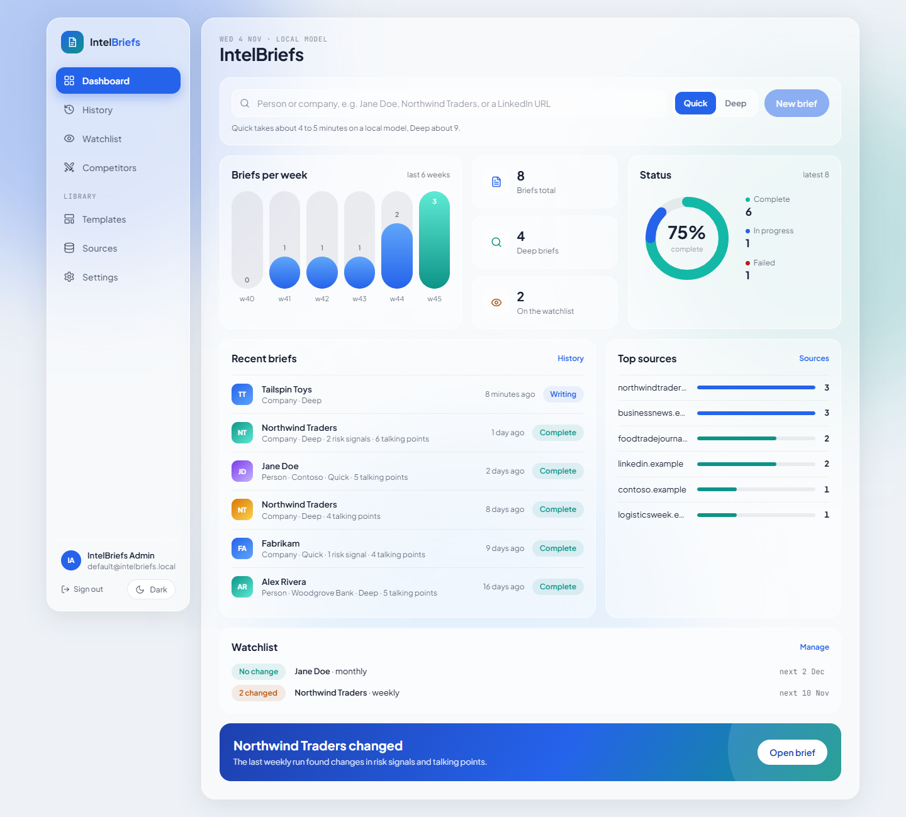
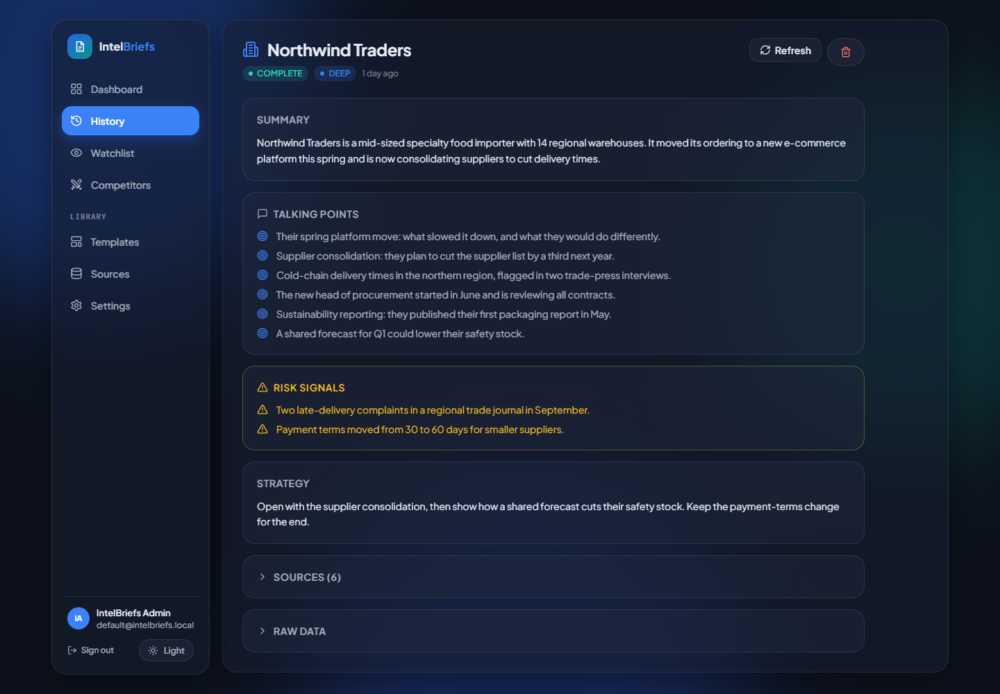
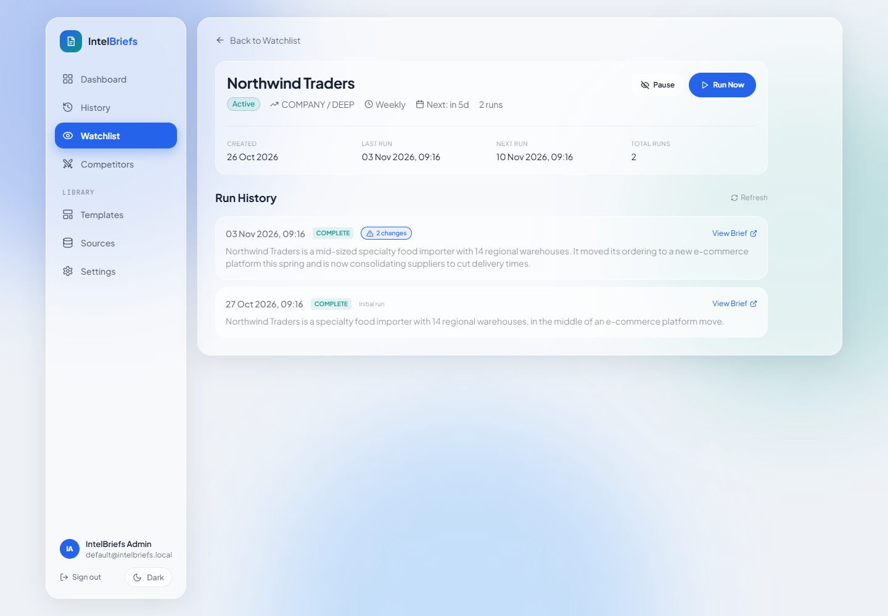

# IntelBriefs

Research briefs for meetings. Type a person or a company; IntelBriefs searches the web, then a model on your own machine writes a one-page brief: who they are, what matters to them, talking points, risk signals and a suggested approach, with every source linked.



## Why

Before a call you want five minutes of useful background, not forty open tabs. IntelBriefs does the searching and the first read, keeps every brief, and re-runs the ones you care about on a schedule so you see what changed since last time.

## How it works

```
Name or company -> Web search -> Local model -> Brief (+ sources)
```

1. **Input**: a name, a company, "name company", or a LinkedIn URL. Pick **Quick** or **Deep**.
2. **Search**: [Tavily](https://tavily.com) web search (Quick: 5 results, basic depth; Deep: 10 results, advanced depth). With an [Exa](https://exa.ai) key it also runs a neural search and a LinkedIn lookup. Both are optional; without a key the brief is written from whatever else is available.
3. **Write**: an Ollama model on the host writes the summary, talking points, risk signals and strategy as JSON. Deep runs a second pass for the talking points.
4. **Store**: the brief, its sources and a credibility score per source are saved in Postgres.

On a local 31B model a Quick brief takes about 4 to 5 minutes and a Deep brief about 9. Smaller models are faster.

### What leaves your machine

| Step | Where it runs |
|---|---|
| Writing the brief | Your machine (Ollama) |
| Web search | Tavily / Exa: the name you typed is sent as a search query |
| Optional CRM lookup | Your own CRM, only if `CRM_API_URL` is set |
| Optional LLM gateway | Off unless `LLM_PROVIDER=claude` (see below) |

The search results and every brief stay in your local Postgres.



## Features

- **Briefs**: Quick or Deep, person or company; summary, talking points, risk signals, strategy, sources with credibility scores, raw data. Refresh a brief or export it as PDF.
- **History**: every brief, with search and filters for type (person or company) and mode.
- **Watchlist**: re-run a brief daily, weekly, every two weeks or monthly. Each run is compared with the previous one and the changed sections are shown (summary, talking points, risk signals). A sidecar container calls the scheduler every 15 minutes.
- **Competitors**: track companies, collect mentions (launches, pricing, hiring, partnerships, funding) and generate a digest.
- **Templates**: saved brief layouts for a first meeting, an investor, a hiring manager or your own sections.
- **Sources**: which domains your briefs rely on, with a credibility score you can override per domain.
- Light and dark theme, usable on a phone.



## Quick start

Requirements: Git, Node.js 22 or newer, Docker with Compose, and [Ollama](https://ollama.com) running on the host with one model pulled.

```bash
ollama pull qwen2.5:7b
git clone https://github.com/falshaw/intelbriefs.git
cd intelbriefs
cp .env.example .env
```

Open `.env` and fill in the secrets: `POSTGRES_PASSWORD`, `REDIS_PASSWORD`, `AUTH_SECRET`, `INTELBRIEFS_APP_PASSWORD`, `ENCRYPTION_KEY` and `CRON_SECRET`. Put the same Postgres password into `DATABASE_URL`. Generate each value with either command:

```bash
openssl rand -hex 32
node -e "console.log(require('crypto').randomBytes(32).toString('hex'))"
```

Add a `TAVILY_API_KEY` for web search (the free plan has 1,000 searches a month). You can also set the keys later under **Settings**, where they are stored encrypted.

Start the stack, then create the schema and the admin user from the host:

```bash
docker compose up -d --build
npm install --include=dev
npx prisma generate
npx prisma db push
npx prisma db seed
```

The seed prints the login: `default@intelbriefs.local` and a random password (or `SEED_ADMIN_PASSWORD` if you set it). Open http://localhost:3006.

`npm install --include=dev` matters: the Prisma CLI and `tsx` (used by the seed) are dev dependencies, and npm skips them when `NODE_ENV=production` or `omit=dev` is set.

The stack uses ports 3006 (app), 5438 (Postgres) and 6385 (Redis), all bound to `127.0.0.1`. Stop it with `docker compose down` (add `-v` to delete the data).

## Configuration

| Variable | Default | Purpose |
|---|---|---|
| `OLLAMA_MODEL` | `qwen2.5:7b` | Any Ollama model that returns JSON reliably. Larger models write better briefs. |
| `OLLAMA_HOST` | `http://host.docker.internal:11434` | Ollama on the host, as seen from the container |
| `OLLAMA_TIMEOUT_MS` | `300000` | Timeout per model call |
| `TAVILY_API_KEY` | empty | Web search |
| `EXA_API_KEY` | empty | Extra search in Deep mode |
| `LLM_PROVIDER` | `ollama` | `claude` sends model calls to an optional HTTP gateway instead |
| `CLAUDE_BRIDGE_URL`, `CLAUDE_BRIDGE_TOKEN`, `CLAUDE_MODEL` | | Gateway address, shared token and model name, only with `LLM_PROVIDER=claude` |
| `CRM_API_URL`, `CRM_API_KEY` | empty | Optional CRM lookup and sync; empty turns it off |
| `CRON_SECRET` | required | Shared secret between the scheduler sidecar and `/api/cron/*` |
| `ENCRYPTION_KEY` | required | Encrypts API keys saved under Settings (AES-256-GCM) |

### Optional LLM gateway

With `LLM_PROVIDER=claude` the app POSTs prompts to `CLAUDE_BRIDGE_URL/generate` with an `X-Bridge-Token` header and expects `{ "text": "..." }` back. This keeps any model API key outside the container. You run the gateway yourself; it is not part of this repo. The default, `ollama`, needs nothing extra.

## Architecture

| Container | Role |
|---|---|
| `intelbriefs-app` | Next.js 16 (App Router), API routes, research pipeline |
| `intelbriefs-postgres` | Postgres 16; the app connects as a least-privilege user (`postgres/init-app-user.sh`) |
| `intelbriefs-redis` | Rate limiting |
| `intelbriefs-cron` | Calls the watchlist scheduler every 15 minutes |

Containers run as non-root with dropped capabilities, `no-new-privileges` and memory limits. Sign-in uses Auth.js (credentials, bcrypt); every API route and page checks that the brief, watchlist item or competitor belongs to the signed-in user.

Stack: Next.js 16, React 19, Tailwind CSS 4, Prisma 7 (PrismaPg adapter), Auth.js 5, Postgres 16, Redis 8, Ollama.

## Development

```bash
npm install --include=dev
npx prisma generate
npm run dev        # needs Postgres and Redis from the compose stack
npm run test:run   # Vitest
npm run lint
npx tsc --noEmit
```

## Limits

- A brief is only as good as the search results and the model. Check facts before you rely on them, especially risk signals.
- Without a search key the model has little to work with and briefs get thin.
- The watchlist compares sections as text, so a reworded summary counts as a change.
- One admin user is seeded; there is no self-registration.

## License

MIT, see [LICENSE](LICENSE).
